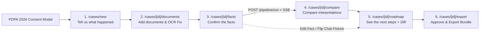

# AinPath Frontend Architecture & UX Specification

> **Document Status:** Planning & UI/UX Engineering Spec (Pre-Implementation)  
> **Target Milestone:** International AI Builders Congress 2026 (26 December 2026, DIU)  
> **API Contract Alignment:** Matches `/backend/backend.md` (`/api/v1/*`, entity enums, clock IDs, and verification statuses 1:1).

---

## 1. Overview & Goals

AinPath's frontend is a **Bangla-first, mobile-accessible legal navigation & evidence-review web application**. It serves three user personas on one shared case workspace:
1. **Primary User (Bangladeshi Buyer):** Often on an Android smartphone over variable 3G/4G bandwidth, submitting a wrong-item Daraz or Facebook Shop dispute in Bangla, English, or Banglish.
2. **Assisted User (Legal-Aid / Consumer Volunteer):** Reviewing receipts, correcting OCR errors in scanned Bangla documents, and confirming trigger dates alongside a buyer.
3. **Secondary User (Legal / Compliance Reviewer):** Inspecting the 3 page-linked Terms of Sale compliance findings, verifying exact statutory quotes, and checking uncertainty flags before pilot approval.

### Frontend Design Principles
- **Zero False Legal Certainty:** Every step, deadline, and finding visually separates `SOURCE_CONFIRMED` / `VERIFIED`, `DISPUTED_FACT_DEPENDENT`, `NEEDS_REVIEW`, and `REFUSED_UNCONFIRMED_TRIGGER` using explicit icons + text labels (never color alone).
- **Evidence-Linked Everything:** Clicking any fact, finding, or deadline anchor opens the exact document page and bounding-box highlight alongside the pinned official authority snapshot.
- **Show What Changed (`Diff`):** When a single fact flips during the live demo or user edit, changed roadmap lines and memo statuses light up inline so cause-and-effect is unmistakable.
- **PDPA 2026 User Control:** Clear Bangla/English consent gate upfront, persistent Privacy Drawer (`LOCAL_OFFLINE` vs `CLOUD_REGIONAL`, retention timer, one-click export & hard delete).

---

## 2. Tech Stack & Justification: Next.js vs. Streamlit

### Explicit Evaluation: Why Next.js Replaces Streamlit as Primary UI
Although the initial proposal suggested **Streamlit** for local simplicity, Streamlit creates severe architectural bottlenecks for AinPath's core demo and mobile users:

| Criterion | Streamlit (Proposal Default) | **Next.js 15 (App Router) + TypeScript + Tailwind** (Recommended) |
|---|---|---|
| **Interactive PDF / Image Bounding Boxes** | Lacks native smooth pan/zoom canvas with synchronized click-to-highlight `(x0, y0, x1, y1)` overlays; requires custom iframes. | Native `pdfjs-dist` canvas + SVG bounding-box layer with instant click-to-anchor jumping. |
| **Inline OCR Manual Correction** | Full-script top-to-bottom Python reruns on every text edit cause jarring UI resets and scroll jumps. | Optimistic local editing (`PATCH .../ocr-override`) with zero page reload and instant low-confidence chip tracking. |
| **Mobile & Low-Bandwidth BD Usage** | Heavy WebSocket payload (~2–5 MB initial JS + rerun round-trips) breaks on intermittent 3G/4G. | Static/edge-cached shell (`< 180 KB` gzipped via Cloudflare Dhaka PoP), client-side image compression before upload, responsive 360px cards. |
| **Side-by-Side & Line-Level Diff View** | Awkward multi-column hacks on mobile; poor diff highlighting ergonomics. | Crisp split-pane on desktop (`>=1024px`) collapsing cleanly to tabbed Buyer/Seller toggle on mobile (`360px`). |
| **Cloud & Offline Parity** | Single-process stateful server scales poorly. | Works 100% locally (`next start` via Docker/localhost alongside FastAPI) AND deploys free to Vercel / Cloudflare Pages / Cloud Run. |

**Recommendation:** Build the 6-screen user application in **Next.js 15 (App Router) + TypeScript + Tailwind CSS + shadcn/ui**, paired with:
- **State & Networking:** **TanStack Query v5** (server cache + optimistic OCR/fact mutations + SSE pipeline listener) + **Zustand** (lightweight draft & bilingual UI state).
- **Document Viewer:** **`pdfjs-dist`** (canvas page rendering + thumbnail strip) + custom SVG bounding-box overlay for both PDFs and JPEG/PNG chat screenshots.
- **Typography & i18n:** `next/font/google` (`Noto Sans Bengali` + `Plus Jakarta Sans` + `JetBrains Mono`) + lightweight typed dictionary (`bn.ts` / `en.ts`, zero heavy runtime overhead) + custom `bnNumerals` helper.

*(Optional Internal Tooling Note: If the AI team wants a 1-file Streamlit internal eval dashboard for inspecting the 24-case batch confusion matrix locally, that may exist strictly as an internal dev script—never as the user/judge UI.)*

---

## 3. User Flows & The Six Core Screens



### Screen 1: Tell Us What Happened (`/cases/new`)
- **Bangla-First Header & Privacy Gate:** Displays non-legal-advice notice + PDPA 2026 consent modal (`LOCAL_OFFLINE` laptop vs `CLOUD_REGIONAL` Mumbai `asia-south1`, retention 24h / 7d / 30d, explicit purpose checkboxes).
- **Inputs:**
  - Purchase channel selector cards: **Daraz Bangladesh (`DARAZ_BD`)**, **Facebook Shop (`FACEBOOK_SHOP`)**, **Other / Unsure (`OUT_OF_SCOPE` check)**.
  - Payment channel selector: **bKash**, **Nagad**, **Rocket**, **Debit/Credit Card**, **Cash on Delivery (COD)**, **Platform Wallet / Gateway**, **Unknown** *(with MFS sub-type hint: P2P Send Money vs Merchant Payment)*.
  - Free-text story box (`Bangla / English / Banglish` placeholder examples; quick-fill demo fixture loader button for rehearsal safety).
- **System Action:** `POST /api/v1/cases` + `POST /api/v1/cases/{id}/consent` → extracts initial structured fields (order date, delivery date, ordered model, received model, seller name, prior return rejection) and redirects to Screen 2.

### Screen 2: Add Documents (`/cases/[id]/documents`)
- **Inputs:** Drag-and-drop / mobile camera upload slots labeled clearly with size & page limits (`Max 10 MB/file, 25 pages/PDF, 8 files`):
  1. Seller Terms of Sale PDF (`TERMS_PDF`)
  2. Order Confirmation / Invoice (`ORDER_RECORD`)
  3. Payment Receipt / bKash-Nagad TrxID (`PAYMENT_RECEIPT`)
  4. Messenger / WhatsApp Chat Screenshots (`CHAT_SCREENSHOT`)
  5. Daraz Rejection Notice / Unboxing Photo (`REJECTION_NOTICE` / `UNBOXING_PHOTO`)
- **Client-Side Pre-Upload Compression:** Resizes phone photos `> 2048px` to WebP/JPEG (`<= 800 KB`) on-device before upload—saving mobile data on slow connections.
- **System Output:** Interactive **Evidence Viewer** showing page thumbnails, OCR engine badge (`PyMuPDF` / `Tesseract ben+eng` / `Cloud Vision`), overall confidence %, red/amber highlights on low-confidence tokens (`< 0.75`), prompt-injection quarantine alerts (if hidden text detected), and inline **Manual OCR Correction** panel (`PATCH .../ocr-override`).

### Screen 3: Confirm the Facts (`/cases/[id]/facts`)
- **Focused Disambiguation (Max 5 Questions):** Only asks questions that change a route, deadline, or compliance finding (e.g., *"What date was the parcel delivered?"*, *"Did 'হ্যাঁ' at 14:02 refer to delivery address or Model B substitution?"*, *"Are seller terms available in Bangla?"*).
- **Fact Confirmation Table:** Each extracted fact displays:
  - Normalized value (e.g., `2026-11-05` + Bangla display `৫ নভেম্বর ২০২৬`)
  - Evidence anchor chip (`ev_02 · p.1`) clickable to preview source
  - 3-state toggle: **`CONFIRMED`**, **`DISPUTED` (preserve both sides)**, or **`MISSING`**.
- **System Action:** `PATCH /api/v1/cases/{id}/facts` → triggers `POST /api/v1/pipeline/run` and streams real-time progress across the 6 pipeline stages (`Intake` → `Deadlines` → `Research` → `Review` → `Verification Pass 1` → `Verification Pass 2`) via SSE.

### Screen 4: Compare Interpretations (`/cases/[id]/compare`)
- **Top Panel — Side-by-Side Buyer vs. Seller Position:** Compares buyer's account vs seller's asserted justification (e.g., Daraz rejection reason or chat reply) on each disputed fact, with missing-context alerts (e.g., *"Need 5 preceding chat timestamps"*).
- **Bottom Panel — Reviewer Compliance Memorandum (3+ Page-Linked Findings):**
  - Displays each `Finding` card (`DELIVERY_UNCLEAR`, `PRIVACY_CONSENT`, `WARRANTY_CONFLICT`, `TERMS_NOT_BANGLA`, etc.).
  - Shows **Authority Strength Badge** (`STATUTE` vs `GUIDELINE` vs `PLATFORM_POLICY`), **Verification Status** (`VERIFIED`, `DISPUTED_FACT_DEPENDENT`, `NEEDS_REVIEW`), and **Pass 2 Independent Check** outcome (`PASS` or objection note).
  - Clicking **Inspect Source** opens a split drawer showing (a) highlighted PDF page snippet on the left, and (b) full pinned legal passage + snapshot date + official URL + `url_status` on the right (`GET /api/v1/authorities/{id}`).

### Screen 5: See the Next Steps (`/cases/[id]/roadmap`)
- **Dual-Clock Deadline Strip:** Displays separate non-merged clock cards (`DARAZ_RETURN_14D`, `CRPA_S60_30D`, `CRPA_S61_90D`, `DCOG_COMPLAINT_72H`, `CARD_CHARGEBACK`, etc.) showing trigger date, source anchor, or explicit **`REFUSED_UNCONFIRMED_TRIGGER`** warning.
- **Prioritized Action Roadmap:** Channel + Payment-aware step cards (e.g., Step 1: Daraz Support follow-up or Seller 72h written notice; Step 2: bKash `16247` / BB CIPC `16236` / Card Chargeback branch; Step 3: DNCRP CCMS `dncrp.com` written complaint—never auto-submitted). Each step lists prerequisites, attachments needed, and eligibility badge (`SOURCE_CONFIRMED` / `DISPUTED_FACT_DEPENDENT` / `NEEDS_REVIEW`).
- **Evidence-Sensitivity Diff Banner & Inline Highlighter:** When `base_run_id` exists (e.g., after toggling chat context or editing a date), displays a **What Changed (`diff`)** banner showing reused vs recomputed stages and highlighting added/modified lines in green/amber directly inside the roadmap and findings!

### Screen 6: Export (`/cases/[id]/export`)
- **Human Approval Gate:** User cannot export until reviewing and optionally editing the generated **Buyer Complaint / Follow-Up Draft** (Bangla/English) and checking an explicit confirmation box (*"I reviewed the facts, dates, and official links; AinPath is not submitting this for me"*).
- **Bundle Options (`POST /api/v1/cases/{id}/export`):**
  1. **Buyer Action Pack** (Editable DNCRP / Daraz follow-up draft + Document Checklist + Official portal URLs)
  2. **Sourced Reviewer Memorandum** (3+ findings, counterarguments, Pass 1/2 audit trail, pinned authority snapshots, unresolved items)
  3. **Full Case Evidence Index** (`PDF` + `Markdown` + `JSON` portable archive)

---

## 4. Component & Folder Structure

```text
frontend/
├── package.json
├── next.config.ts
├── tailwind.config.ts
├── tsconfig.json
└── src/
    ├── app/
    │   ├── layout.tsx                        # Noto Sans Bengali + Plus Jakarta Sans fonts, theme, QueryProvider
    │   ├── page.tsx                          # Landing + problem/privacy overview + start/demo CTA
    │   └── cases/
    │       ├── new/page.tsx                  # Screen 1: Tell us what happened + Consent Modal
    │       └── [id]/
    │           ├── layout.tsx                # 6-step stepper + Language Toggle + Privacy/Delete Drawer
    │           ├── documents/page.tsx        # Screen 2: Uploads + Evidence Viewer + OCR Override
    │           ├── facts/page.tsx            # Screen 3: Disambiguation + Fact Confirmation + SSE Run
    │           ├── compare/page.tsx          # Screen 4: Buyer vs Seller + Reviewer Memo + Citation Drawer
    │           ├── roadmap/page.tsx          # Screen 5: Dual Clocks + Action Steps + Diff View
    │           └── export/page.tsx           # Screen 6: Editable Draft + Approval Gate + Bundle Download
    ├── components/
    │   ├── layout/
    │   │   ├── StepperNav.tsx                # Accessible 6-step mobile/desktop progress bar
    │   │   ├── BilingualToggle.tsx           # Instant bn <-> en switch + Bengali numeral toggle
    │   │   ├── PrivacyConsentModal.tsx       # PDPA 2026 explicit consent + mode/retention selector
    │   │   └── PrivacyControlDrawer.tsx      # Case TTL countdown, JSON export, Hard Delete confirm
    │   ├── evidence/
    │   │   ├── UploadDropzone.tsx            # Magic-type check, size/page guard, client image compression
    │   │   ├── EvidenceViewer.tsx            # PDF.js canvas + screenshot pan/zoom + bounding-box SVG
    │   │   ├── OcrConfidenceBar.tsx          # Flags <0.75 tokens + injection warning banner
    │   │   └── OcrCorrectionEditor.tsx       # Side-by-side raw vs user-corrected text editor
    │   ├── analysis/
    │   │   ├── FactDisputeCard.tsx           # CONFIRMED / DISPUTED / MISSING selector + anchor link
    │   │   ├── SideBySideCompare.tsx         # Buyer reading vs Seller reading + missing-context callouts
    │   │   ├── FindingCard.tsx               # Page anchor, AuthorityStrengthBadge, Pass2 verdict
    │   │   └── CitationDrawer.tsx            # Pinned legal passage, snapshot date, URL liveness status
    │   ├── roadmap/
    │   │   ├── DeadlineClockGrid.tsx         # Dual clocks + REFUSED_UNCONFIRMED_TRIGGER state card
    │   │   ├── RouteStepCard.tsx             # Channel + payment branch steps + official outbound link
    │   │   └── DiffHighlighter.tsx           # Changed-line diff view (base_run_id vs target_run_id)
    │   └── common/
    │       ├── StatusBadge.tsx               # Accessible icon + text badges (never color-only)
    │       ├── AuthorityStrengthBadge.tsx    # Statute / Guideline / Official Guide / Platform / Evidence
    │       └── UncertaintyStateBanner.tsx    # Handles 6 failure/uncertainty UI modes
    ├── lib/
    │   ├── api-client.ts                     # Typed fetch wrapper + Case Token auth + error mapper
    │   ├── sse-pipeline.ts                   # EventSource hook for real-time 4-agent stage progress
    │   ├── bn-format.ts                      # Bengali numerals (০-৯), BST dates, Banglish helper tags
    │   ├── image-compress.ts                 # Canvas compressor for 3G/4G mobile photo uploads
    │   └── i18n/
    │       ├── bn.ts                         # Natural, plain-language Bangladeshi Bangla copy
    │       └── en.ts                         # Parallel English copy
    ├── store/
    │   └── caseStore.ts                      # Zustand: languagePref, activeRunId, baseRunId, demoMode
    └── types/
        └── api.ts                            # Strict TypeScript interfaces mirrored from backend schemas
```

---

## 5. Evidence Viewer, Confidence Flags & Manual OCR Correction

1. **Page Thumbnails & Anchor Navigation:** Renders PDF pages via `pdfjs-dist` (lazy per-page rendering to save RAM on budget phones) or high-DPI image previews for WhatsApp/Messenger screenshots. Clicking any citation (`TERMS_PDF:page=4,line=18`) scrolls directly to Page 4 and pulses the bounding-box overlay `[x0, y0, x1, y1]`.
2. **OCR Confidence & Visual Heat Flags:**
   - Words/lines from `bbox_anchors_json` with `conf < 0.75` receive an amber dashed underline (`Needs check / যাচাই প্রয়োজন`); `< 0.50` or flagged Bengali numerals/dates receive a red dashed border.
   - Displays OCR engine metadata (`Tesseract ben+eng · 84% avg confidence` vs `PyMuPDF born-digital · 99%` vs `Cloud Vision`).
3. **Inline Manual Correction Flow:**
   - Clicking a flagged region opens an inline Bangla/English edit box pre-populated with `raw_text`, alongside a zoomed crop of that exact image region so the user reads the original ink directly!
   - Saving calls `PATCH /api/v1/cases/{id}/evidence/{ev_id}/ocr-override`, updating `user_corrected_text`, locking that field as human-verified, and marking downstream DAG nodes dirty (`"Re-run affected analysis"` prompt).
4. **Prompt-Injection Banner:** If `injection_flags` is non-empty, renders a high-visibility security card above the page (`"Hidden or instruction-like text quarantined on Page 2 — treated strictly as untrusted evidence"`).

---

## 6. Side-by-Side Buyer vs. Seller View (Screen 4)

- **Desktop (`>=1024px`):** Strict 2-column split panel; **Mobile (`<768px`):** Sticky segmented switch (`Buyer Reading / ক্রেতার অবস্থান` ↔ `Seller Reading / বিক্রেতার দাবি`) with a `"Show Differences"` toggle so small screens remain uncluttered.
- Each disputed issue (e.g., `substitution_consent`) displays:
  - **Buyer Position:** Quote + anchor (`Chat Screenshot p.1: "হ্যাঁ বাসা মিরপুর ১০"` → confirms delivery address).
  - **Seller Position:** Rejection basis (`Daraz Rejection: "Buyer agreed to substitute Model B"`).
  - **Missing Context Box:** Explicitly names what resolves the standoff (`"Upload 5 preceding timestamped messages before 14:02"`).
  - **Governing Authority & Strength:** e.g., `CRPA 2009 s.45 [STATUTE]` + `Daraz Return Policy [PLATFORM_POLICY]`.
- Below the comparison sits the **Reviewer Memorandum** listing the 3+ page-linked compliance risks with expandable **Pass 1 / Pass 2 Verification Audit** pills (`Quote Match: 100%`, `Hierarchy Check: PASS`, `Pass 2 Independent Check: PASS / FLAG_MISSING_EXCEPTION`).

---

## 7. Roadmap View with Changed-Line Highlighting (Screen 5)

The **Evidence-Sensitivity Diff View** directly proves AinPath's core technical claim to judges:

1. Whenever `base_run_id != target_run_id`, Screen 5 fetches `GET /api/v1/cases/{id}/diff?base_run_id=...&target_run_id=...`.
2. **DAG Cache Pill Strip:** Shows judges & reviewers which pipeline nodes were reused vs recomputed:
   - `[✓ Skipped: OCR & PDF Ingestion]` `[✓ Skipped: Deadline Clocks]` `[↻ Recomputed: Review Agent, Route Engine, Verification Pass 1 & 2]`
3. **Inline Line-Level Diff:**
   - **Modified Steps/Findings:** Strikethrough old line (`bg-rose-50 border-l-4 border-rose-500`) directly above new line (`bg-emerald-50 border-l-4 border-emerald-600`).
   - **Status Delta Pill:** e.g., `SOURCE_CONFIRMED → DISPUTED_FACT_DEPENDENT`.
   - **One-Click Fixture Switcher (Demo Mode Flag):** Allows toggling a live demo case between `"Address Confirmation"` and `"Substitution Approval"` right on Screen 3/5 without re-uploading PDFs, showing deterministic dependency reruns live in seconds!

---

## 8. Deadline Display Component (`DeadlineClockGrid`)

Deadlines are **never merged into one countdown**. Each active clock renders in its own distinct card:

| Card | Visual Behaviour |
|---|---|
| **`DARAZ_RETURN_14D`** *(Marketplace Clock)* | Shows `14 days from delivery` (`DARAZ_BD_RETURN_2025`), exact trigger date + anchor, days remaining (`৭ দিন বাকি`), and category caveat (`Unused, tags intact; SIM/Wi-Fi activation excluded`). |
| **`CRPA_S60_30D`** *(Statutory Consumer Clock)* | Shows `30 days from cause of action` (`CRPA 2009 s.60 [STATUTE]`). If `delivery_date` and `rejection_date` differ, displays **earlier conservative deadline** prominently + secondary note explaining both possible triggers for legal review. |
| **`CRPA_S61_90D`** *(Magistrate Cognizance Clock)* | Hidden/collapsed as `NOT_APPLICABLE` until buyer confirms a DNCRP written complaint was filed; then tracks 90 days from `dncrp_complaint_filed_date`. |
| **`DCOG_COMPLAINT_72H` / `DCOG_REFUND_10D`** | Clearly badged **`GUIDELINE (Policy, not Statute)`**; tracks seller 72h complaint reply and 10-day same-channel refund clocks. |
| **`CARD_CHARGEBACK` / `BANGLA_QR_45D`** | Appears dynamically when `payment_channel` is Card or Bangla QR MFS; shows `VERIFY` advisory for card issuer windows. |
| **`REFUSED_UNCONFIRMED_TRIGGER`** *(Safety State)* | Renders a locked gray/amber card: **`সময়সীমা গণনা স্থগিত (Deadline Refused)`** — *"Delivery date is unconfirmed or disputed between Invoice (Nov 4) and Courier SMS (Nov 7). Confirm trigger date on Screen 3 to compute exact remaining days."* |

---

## 9. State Management & API Integration

- **TanStack Query Keys:**
  - `['case', caseId]` (`GET /api/v1/cases/{id}`)
  - `['compare', caseId, activeRunId]` (`GET .../compare`)
  - `['roadmap', caseId, activeRunId]` (`GET .../roadmap`)
  - `['memo', caseId, activeRunId]` (`GET .../memo`)
  - `['diff', caseId, baseRunId, targetRunId]` (`GET .../diff`)
  - `['authority', authorityId]` (`GET /api/v1/authorities/{id}`, `staleTime: Infinity` since snapshots are immutable)
- **Pipeline SSE Integration (`sse-pipeline.ts`):**
  - Opens `EventSource` to `/api/v1/cases/{id}/pipeline/runs/{run_id}/stream`.
  - Updates step checklist in real time (`intake` → `deadlines` → `routes` → `research` → `review` → `verify_p1` → `verify_p2`).
  - Automatically invalidates `['compare']`, `['roadmap']`, `['memo']`, and `['diff']` upon `event: completed`.
  - Falls back automatically to 2-second polling (`GET /cases/{id}`) if SSE is blocked by an institutional proxy/campus Wi-Fi.

---

## 10. Bangla-First UI, Low-Bandwidth & Accessibility

1. **Bangla-First Typography & Copy:**
   - Primary font: **`Noto Sans Bengali`** (`weight: 400, 500, 600, 700`) with `line-height: 1.65` (Bangla matra & vowel modifiers clip at tight English line-heights like `1.2`!). Paired with **`Plus Jakarta Sans`** for Latin/UI tokens.
   - Copy written in plain conversational Bangladeshi Bangla (avoiding heavy Sanskritized/archaic *sadhu-bhasha* except when quoting exact statutory text in the citation drawer, paired with a plain-Bangla summary!).
2. **Instant Bilingual Toggle & Bengali Numerals:**
   - Top-bar `বাংলা | EN` switch updates labels immediately via Zustand without clearing unsaved inputs.
   - `bn-format.ts` formats display numbers and dates in Bengali digits (`০১-০৯`, e.g., `১৪ দিন`, `৩০ দিন`, `৫ নভেম্বর ২০২৬`) when `language_pref === 'bn'`, while inputs accept **both** Bengali digits (`৫/১১/২০২৬`), English digits (`05/11/2026`), and Banglish words seamlessly.
3. **Low-Bandwidth & Mobile-First Design:**
   - Mobile-first `360px` single-column card layout; minimum `44×44px` tap targets.
   - Progressive PDF thumbnail fetching (only visible page rendered via PDF.js); automatic image downscaling before upload (`max 2048px`, WebP/JPEG quality `0.8`).
   - Total initial JS budget `< 200 KB` gzipped so Screen 1 loads cleanly even on 2G/3G campus or rural mobile data.
4. **Accessibility (WCAG 2.1 AA):**
   - Every status badge combines **icon + text label + high-contrast fill** (`>= 4.5:1`), never relying on red/green color alone.
   - Full keyboard navigation (`Tab` / `Esc` closes Citation & Privacy drawers, `aria-live="polite"` announces SSE pipeline progress and OCR save confirmations).

---

## 11. Error, Loading & Uncertainty States

Every edge/failure scenario from the proposal and legal audit has a dedicated, testable UI state (`UncertaintyStateBanner.tsx`):

| Scenario | Exact UI Handling & Copy Behavior |
|---|---|
| **1. Conflicting Dates** | Displays both dates side by side with evidence anchors (`Invoice: Nov 4` vs `Courier SMS: Nov 7`), forces `REFUSED_UNCONFIRMED_TRIGGER` on dependent deadlines, and offers 1-click jump to Screen 3 to confirm or preserve dispute. |
| **2. Missing Proof** | Highlights exact gap inside the Roadmap step (e.g., *"Facebook seller lacks receipt/TrxID"*), prevents `SOURCE_CONFIRMED` badge, and lists specific steps to collect bKash TrxID + page URL + full chat export without discarding existing files. |
| **3. Weak Legal Support / Pass 2 Rejection** | Never hides or promotes weak claims: moves `NEEDS_REVIEW` / `FLAG_MISGROUNDED` items into an **"Unresolved / Reviewer Attention Required"** collapsible panel at the bottom of the memo, displaying the exact Pass 2 objection alongside it. |
| **4. Stale Policy or Unavailable Official Portal** | Displays pinned `snapshot_date` warning (`"dncrp.com link check flagged unreachable on 2026-11-20 — showing pinned filing instructions"`), and surfaces verified fallback routes from the pinned guide (`nccc@dncrp.gov.bd`, Divisional/District DNCRP office, District Magistrate). |
| **5. Unreadable OCR or Prompt Injection** | Unreadable scans block auto-extraction of affected fields and prompt manual zoom-crop typing on Screen 2; detected prompt injections show a quarantine banner and strip imperative commands while keeping raw text inspectable as evidence. |
| **6. Out-of-Scope Dispute** | Cleanly terminates automated routing with an `"Outside Prototype Scope"` card summarizing collected facts/evidence and explaining civil remedies (`CRPA ss.66–67`) or advocate referral rather than forcing a wrong Daraz/DNCRP step. |

---

## 12. Consent & Delete Flows (PDPA 2026 UI)

- **Pre-Upload Consent Modal:** Triggered before any file upload or `CLOUD_REGIONAL` LLM processing:
  - Plain-Bangla & English explanation of what data is read, where it runs (`Local Device` vs `Mumbai Cloud asia-south1`), retention period (`24 hours` / `7 days` / `30 days`), and warning **not** to upload NID cards or unrelated personal chats.
  - Explicit checkbox + `Accept & Continue` / `Use Local-Only Mode` buttons.
- **Persistent Privacy Control Drawer** (accessible in top header on every screen):
  - Shows active `processing_mode`, `cloud_region`, redaction count (`"3 phone numbers & 1 TrxID masked before cloud LLM"`), and remaining retention countdown.
  - **Withdraw Consent (`POST .../consent/withdraw`)**, **Download My Case Data (`JSON + ZIP`)**, and **Delete Permanently (`DELETE /api/v1/cases/{id}`)** with typed confirmation (`DELETE`) that immediately clears server storage, `sessionStorage` token, and redirects cleanly.

---

## 13. Frontend Testing Strategy

1. **Unit Tests (`Vitest`):**
   - `bn-format.ts`: Bengali numeral conversion (`০–৯`), ambiguous date formatting, Banglish indicator parsing.
   - `DiffHighlighter`: Snapshot diff edge cases (line added, modified, removed, unchanged).
   - `DeadlineClockGrid`: Verifies `REFUSED_UNCONFIRMED_TRIGGER` never renders a numeric countdown.
2. **Component Tests (`React Testing Library`):**
   - Consent modal blocks upload until explicit consent recorded.
   - Manual OCR editor preserves `raw_text` badge while saving `user_corrected_text`.
   - Status badges include accessible text/ARIA attributes.
3. **End-to-End Tests (`Playwright`):**
   - Full 6-screen Daraz rejection flow + chat fixture flip diff verification (`base_run_id` → `target_run_id`).
   - Full Facebook shop missing-receipt + Bangla-terms-risk flow.
   - Mobile `390×844` viewport test + `axe-core` zero critical WCAG violations check.

---

## 14. Frontend Deployment Plan

- **Primary Cloud Hosting:** **Vercel** or **Cloudflare Pages** (`$0` Hobby/Free tier, edge CDN with **Dhaka `DAC` PoP** delivering `< 20 ms` static asset load across Bangladesh). Calls backend Cloud Run API over HTTPS (`NEXT_PUBLIC_API_BASE_URL`).
- **Local / Offline Fallback:** Bundled `next build && next start` inside the competition laptop `docker-compose.yml` (port `3000` → FastAPI `8000`) so the entire 6-screen demo runs with Wi-Fi turned off.

---

## 15. Step-by-Step Frontend Implementation Roadmap (5 Weeks: Nov 20 – Dec 26, 2026)

| Week | Dates | Frontend Deliverables | Acceptance Gate |
|---|---|---|---|
| **Week 1** | Nov 20 – Nov 26 | Scaffold Next.js 15 + Tailwind + `Noto Sans Bengali` + `bn/en` i18n dictionary + shared `types/api.ts`; build PDPA Consent Modal, Privacy Drawer, and Screen 1 (`/cases/new`). | Bilingual toggle, Bengali numerals, and Consent gate work cleanly on `360px` mobile & desktop. |
| **Week 2** | Nov 27 – Dec 3 | Build Screen 2 (`/documents`) with client image compression, `PDF.js` thumbnail viewer, SVG bounding-box overlays, `<0.75` OCR confidence flags, and inline `PATCH .../ocr-override` editor. | Upload 4-page Terms PDF + screenshot, zoom into low-confidence Bangla line, edit & save correction. |
| **Week 3** | Dec 4 – Dec 10 | Build Screen 3 (`/facts`) with max-5 disambiguation Qs & SSE pipeline progress bar; build Screen 4 (`/compare`) with Buyer/Seller split view, 3-finding memo, and Citation Drawer. | Live SSE run completes; clicking finding anchor highlights exact PDF clause & pinned statute snapshot. |
| **Week 4** | Dec 11 – Dec 17 | Build Screen 5 (`/roadmap`) with Dual-Clock `DeadlineClockGrid`, payment-aware `RouteStepCard`, and `DiffHighlighter`; build Screen 6 (`/export`) approval gate + bundle download. | Flipping chat fixture on Screen 3 highlights exact changed roadmap & memo lines on Screen 5. |
| **Week 5** | Dec 18 – Dec 26 | Implement all 6 Uncertainty/Error banners; run Playwright E2E + Axe accessibility + 3G throttling tests; deploy to Cloudflare Pages/Vercel + verify offline Docker laptop bundle. | Zero E2E failures on both live cloud URL and offline localhost demo for the 3-minute rehearsal. |
